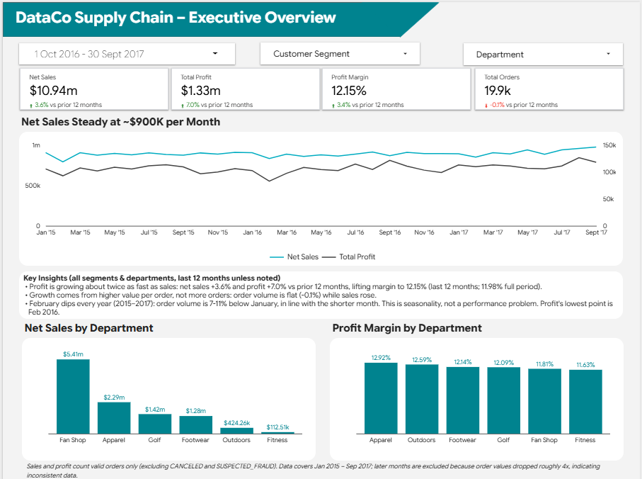
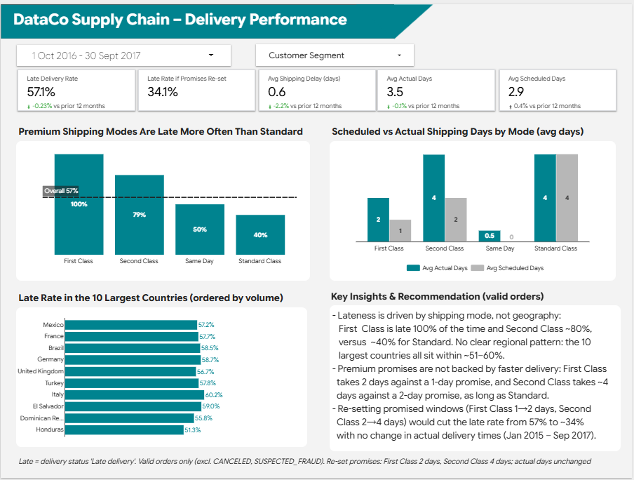
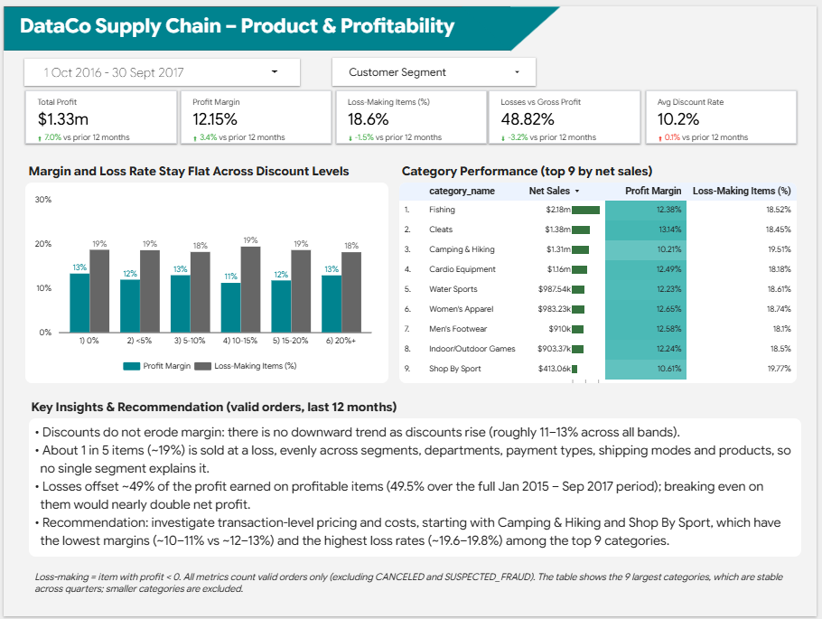

# DataCo Supply Chain Performance Dashboard

End-to-end analytics project: **BigQuery (SQL) → Data Studio** on the Kaggle *DataCo Smart Supply Chain* dataset.
The dashboard answers three business questions about sales, delivery and profitability.

🔗 **Live dashboard:** [Open in Data Studio](https://datastudio.google.com/reporting/1186b0c8-aa28-40fa-b831-02dec486b713)





## Business questions
1. **Executive overview** – How are sales, profit and orders trending, and what drives growth?
2. **Delivery performance** – How often do we deliver late, and what causes it?
3. **Product & profitability** – Do discounts hurt margin, and where is profit leaking?

## Key findings
Growth and category figures are for the last 12 months (Oct 2016 – Sep 2017, compared with the prior 12 months); all other figures cover the full period (Jan 2015 – Sep 2017).

| Area | Finding |
|---|---|
| Growth | Profit grew ~2× faster than sales (+7.0% vs +3.6% vs the prior 12 months); order count was flat (−0.1%), so growth came from higher value per order. Profit margin 12.15%. |
| Delivery | **57.3%** of valid orders arrive late (57.1% in the last 12 months). Lateness is driven by the *shipping mode*, not geography: First Class always takes 2 days against a 1-day promise (100% late), Second Class ~80% late, Standard ~40%. |
| What-if | Re-setting promises to what is actually delivered (First Class 1→2 days, Second Class 2→4 days) would cut the late rate from 57.3% to **~34.1%**, with actual delivery times unchanged. |
| Discounts | Discount level does not change margin (stays ~11–13% across discount bands). |
| Profit leakage | ~**19%** of items are sold at a loss, evenly spread across products, segments and shipping modes. Losses of **$3.5M offset ~50%** of the $7.0M positive profit. In the last 12 months, the lowest margins are Camping & Hiking (10.2%) and Shop By Sport (10.6%), vs ~12–13% for the other top categories. |

**Recommendations:** (1) align delivery promises with real performance by shipping mode; (2) investigate transaction-level pricing and cost for loss-making items, starting with the lowest-margin categories.

## Architecture
```
Kaggle CSV ──► raw.dataco_orders ──► staging.stg_orders (view) ──► mart.fct_orders (table) ──► Data Studio
                 raw.country_mapping ───────────────────────────────▲
```
| Layer | Object | Purpose |
|---|---|---|
| raw | `dataco_orders`, `country_mapping` | Original CSV + seed table translating Spanish country names (164 countries) to English / ISO-2 |
| staging | `stg_orders` | snake_case columns, derived `ship_delay_days`, `is_late`; PII columns dropped |
| mart | `fct_orders` | Dashboard-ready fact table, 1 row = 1 order item, clustered by `market, category_name` |

## SQL files
| File | What it does |
|---|---|
| [`01_stg_orders.sql`](sql/01_stg_orders.sql) | Staging view |
| [`02_data_profiling.sql`](sql/02_data_profiling.sql) | Row counts, date range, status mix, monthly trend |
| [`03_country_mapping.sql`](sql/03_country_mapping.sql) | Country translation seed table |
| [`04_fct_orders.sql`](sql/04_fct_orders.sql) | Final fact table |
| [`05_delivery_analysis.sql`](sql/05_delivery_analysis.sql) | Late-rate drill-down and what-if |
| [`06_profitability_analysis.sql`](sql/06_profitability_analysis.sql) | Discount bands, loss rate, profit leakage |

## Data-quality decisions
- **Period limited to Jan 2015 – Sep 2017.** From Oct 2017 order counts rise while value per order collapses (~$596 → ~$140), which looks like a data artefact, not real behaviour.
- **Valid sales = excluding `CANCELED` and `SUSPECTED_FRAUD`.** All KPIs use valid orders only; orders are counted as distinct `order_id` (`COUNT(DISTINCT order_id)`) because the grain is one row per item.
- **Country names** were Spanish/inconsistent → mapped through `country_mapping`.
- **No market-level conclusions.** Market is confounded with time (each quarter is dominated by 1–2 markets), so comparisons use dimensions that are stable across quarters (department, segment, shipping mode, top categories).
- **Country late rates** are shown for the 10 largest countries only; differences between countries are small-sample noise.

## Limitations
- The regularities in this dataset (e.g. loss-making items spread uniformly across every dimension; scheduled shipping days fixed per mode and First Class always taking exactly 2 days) suggest it is **synthetic**. Findings illustrate the analysis approach rather than a real company's performance.
- BigQuery Sandbox expires tables after 60 days, so `fct_orders` is not partitioned and the Data Studio report uses an extracted data source. With billing enabled, add `PARTITION BY DATE_TRUNC(order_date, MONTH)`.

## Tech stack
BigQuery (SQL, views, clustering) · Data Studio (calculated fields, date comparison, controls) · Git/GitHub

## Data source
[DataCo Smart Supply Chain for Big Data Analysis – Kaggle](https://www.kaggle.com/datasets/shashwatwork/dataco-smart-supply-chain-for-big-data-analysis). The raw CSV is not included in this repo (size and personal-data fields); download it from Kaggle to reproduce.

## Author
Nabila Karima Azka · [GitHub](https://github.com/nabilakarimaazka)
